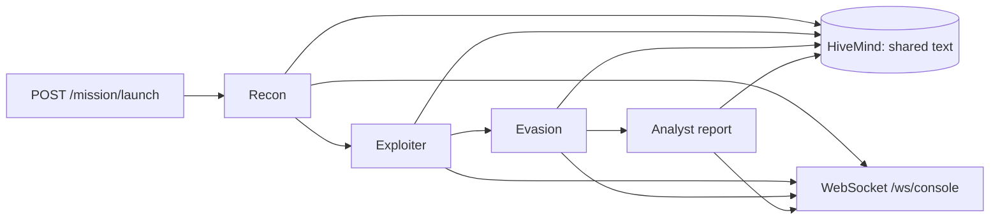

# Shadow-Swarm

> A small FastAPI backend that runs four sequential LLM personas (recon, exploit, evasion, analyst) and streams their output over a WebSocket, as a mock-first sketch of an AI red-team workflow.

**Status:** Early prototype, backend only. The `shadow-console/` front end is not in this repository. Default mode is an offline mock.
**Demo:** none. Not deployed, no video.

## What is actually here

- `backend/main.py`: FastAPI app with `GET /`, `POST /mission/launch` and a WebSocket at `/ws/console`.
- `backend/agent_swarm.py`: `AgentSwarm` runs four agents one after another (Recon, Exploiter, Evasion, Analyst). They share a `HiveMind` object that holds each stage's text so the next stage can use it. Each step is logged to the WebSocket.
- Providers, chosen by `LLM_PROVIDER`:
  - `mock` (default): returns pre-written pentest-style narrative text. It makes no network calls and touches no target.
  - `anthropic`, `openai`, `ollama`: send a pentest-framed prompt to that provider's API with `httpx` and return the text.
- The `target` you submit is only a string placed into the prompts. **No module in this repo scans, connects to, fuzzes or attacks the target.** The output is model-written or canned text, not findings from real testing.



## Quickstart

Not run end to end by the author of this README; the steps follow the code. Needs Python 3.

```bash
cd backend
pip install -r requirements.txt
cp .env.example .env        # LLM_PROVIDER=mock is the default
python main.py              # serves on http://0.0.0.0:8000
```

Or `uvicorn main:app --reload` from `backend/`. `run_backend.ps1` does the same on Windows but expects a `backend/venv` you create yourself.

Use mock mode unless you have a reason not to, and only submit targets you are authorized to test. `requirements.txt` lists several packages the code never imports (`langchain`, `openai`, `anthropic`, `motor`, `redis`); the code uses `fastapi`, `uvicorn`, `pydantic`, `httpx`, `python-dotenv` and `websockets`.

## Configuration

Set in `backend/.env` (template: `backend/.env.example`).

| Variable | Default | Purpose |
| :-- | :-- | :-- |
| `LLM_PROVIDER` | `mock` | `mock`, `anthropic`, `openai` or `ollama` |
| `ANTHROPIC_API_KEY`, `ANTHROPIC_MODEL` | none, `claude-3-5-sonnet-20241022` | Anthropic provider |
| `OPENAI_API_KEY`, `OPENAI_MODEL`, `OPENAI_API_BASE` | none, `gpt-4o-mini`, `https://api.openai.com/v1` | OpenAI-compatible provider |
| `OLLAMA_API_BASE`, `OLLAMA_MODEL` | `http://127.0.0.1:11434`, `llama3:8b` | Local Ollama provider |
| `SWARM_DELAY_FACTOR` | `1.0` | Delay scaling in mock mode |
| `SWARM_VERBOSE` | `true` | Listed in `.env.example`; not read by the code |

## Limitations

- **Missing console.** `shadow-console/` is an empty git submodule pointer (gitlink to commit `afde417`) with no `.gitmodules` and no files. The Next.js dashboard, `run_frontend.ps1` and the Next.js badge describe code that is not here.
- **Not implemented, although earlier versions of this README described them:** automated prompt-injection fuzzing, Base64 / markdown-smuggling / multi-lingual payload generation, a guardrail breach evaluator, a vulnerability scorecard, attack replay logs, and detection of system-prompt exfiltration or unauthorized tool use. The Analyst agent returns a canned (mock) or model-written report.
- **Not a test harness for LLM guardrails.** The LLM calls go to the configured provider, not to the target; nothing evaluates a target's responses.
- **Provider errors are hidden.** Any exception in a live provider call falls back silently to mock output (`agent_swarm.py`), so a live run may actually be mock text.
- **No authorization or target allowlist.** `/mission/launch` has no authentication, CORS is `*` with credentials, and `python main.py` binds `0.0.0.0`. Do not expose it on a network.
- **No tests, no CI.**
- Repository history: the first commit added a `backend/venv/` that was later removed, so `.git` is large. `.env` in that commit held placeholders only.

## Responsible use

For authorized security assessment and AI safety research only. Do not point any extension of this code at systems you do not own or have written permission to test.

## License

MIT, see [LICENSE](LICENSE).
