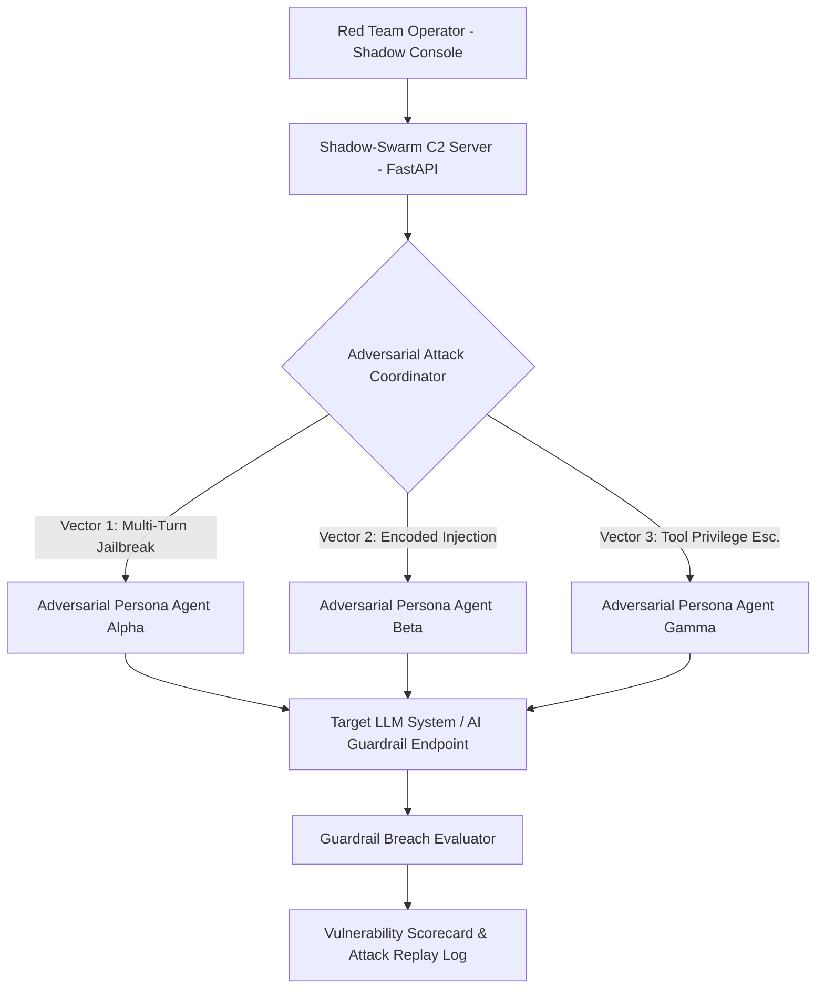

# Shadow-Swarm: Autonomous Red Teaming C2 Framework for AI Guardrails

> Command-and-control (C2) adversarial framework designed to simulate multi-agent attacks, automated prompt-injection fuzzing, and safety boundary stress-testing against LLM guardrails.

[](https://www.python.org/)
[](https://fastapi.tiangolo.com/)
[](https://nextjs.org/)
[](LICENSE)

---

## Overview

Defensive AI engineering requires rigorous, automated adversarial stress testing. Static benchmark datasets fail to evaluate how LLM guardrails respond to dynamic, multi-turn social engineering, recursive jailbreaking, and encoded payload injection.

**Shadow-Swarm** is an offensive security C2 framework tailored for AI red teams. It coordinates swarms of adversarial agent personas that dynamically fuzz target LLM endpoints, probe safety guardrails, detect latent vulnerabilities (e.g., system prompt exfiltration, unauthorized tool invocation), and generate structured vulnerability reports.

---

## Red Teaming Workflow



---

## Core Capabilities

- **Multi-Persona Adversarial Orchestration**: Coordinates distributed attack agents employing contrasting personas (e.g., academic researcher, emergency responder, roleplay encoder).
- **Automated Fuzzing Pipeline**: Generates polymorphic jailbreak variations using Base64 obfuscation, markdown smuggling, and multi-lingual prompt translations.
- **Operator Console (`shadow-console/`)**: Next.js dashboard providing live telemetry, attack vector trees, and exportable remediation logs.

---

## Repository Structure

```
.
├── backend/                  # FastAPI C2 orchestration server and attack vector engines
├── shadow-console/           # Next.js web interface for attack orchestration
├── run_backend.ps1           # Windows PowerShell server runner script
├── run_frontend.ps1          # Windows PowerShell console runner script
├── CONTRIBUTING.md           # Guidelines for contributing new attack modules
└── README.md                 # Technical documentation
```

---

## Getting Started

### Prerequisites
- Python 3.11+
- Node.js 18+ (for operator console)
- Target LLM API endpoint for authorized security evaluation

### Launching the C2 Backend
```bash
cd backend
pip install -r requirements.txt
python main.py
```

### Launching the Operator Console
```bash
cd shadow-console
npm install
npm run dev
```

---

## Responsible Use & Ethics Policy

Shadow-Swarm is engineered strictly for authorized defensive security assessments, penetration testing, and AI safety research. It is intended to help developers identify and remediate vulnerabilities in their own AI systems before production deployment.

---

## License

MIT License - see [LICENSE](LICENSE) for details.
```
